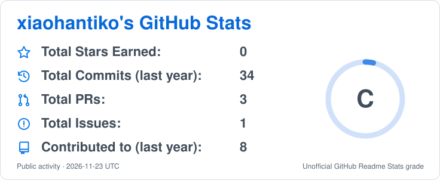

**English** · [简体中文](./README.zh-CN.md) · [日本語](./README.ja.md)

# Hi, I'm han 👋

```swift
let han = (
    github: "@xiaohantiko",
    toolbox: ["Swift", "JavaScript", "Python"]
)
```

I like tinkering with the little things in software that only last a few seconds. I made an opening animation for Codex with a wallpaper and caption I can change. When I'm in a hurry, I just hit Esc. [Codex Startup for macOS](https://github.com/xiaohantiko/codex-startup-showcase)

<picture>
  <source media="(prefers-color-scheme: dark)" srcset="./assets/contribution-snake-dark.svg">
  
</picture>

## A few things I've built

- **Yuban** is an AI companion that lives in QQ. It can check in at a time I choose. If I have a story to tell, I can ask it to wait, send a few messages, and tell it when I'm ready for a reply. [Explore Yuban](https://github.com/xiaohantiko/yuban-showcase)
- **Manxu Studio** is my Mac app for planning motion comics. In the sample project, *A Letter from the Lighthouse*, you can pick a reference image for a character, then storyboard what they do in their first scene. [Explore Manxu Studio](https://github.com/xiaohantiko/manxu-studio-showcase)
- **YiLi** taught me a curious detail about the Four Pillars calendar. Two people born on the same day can have different year pillars if one was born before *Lichun* (the Start of Spring) and the other after it. YiLi accounts for the local time zone at birth and the precise timing of the solar terms. It works offline on Mac and Windows. [Explore YiLi](https://github.com/xiaohantiko/yili-macos)

## My goal for 2027

I want to build my first embedded project in C. Then I’ll try explaining what it does in Japanese, English, German, and Korean, even if it’s just a few sentences in each.


